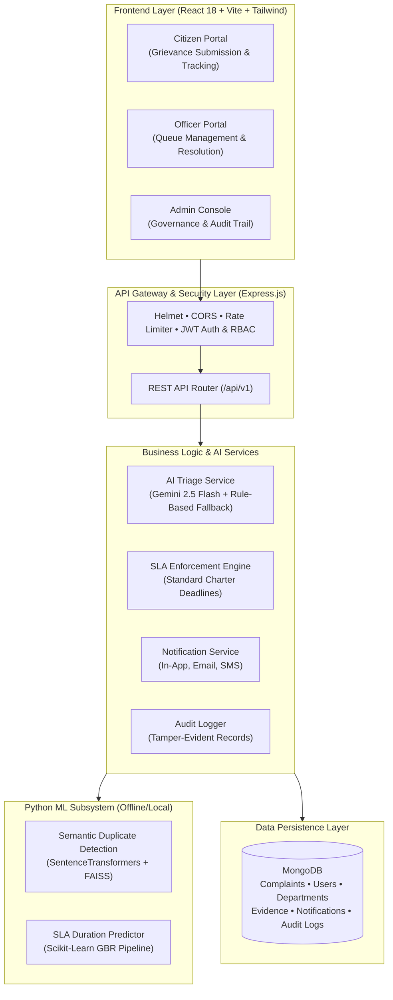

# Nagrik Sahayak (नागरिक सहायक)
### AI-Powered Public Civic Grievance Redressal Platform

> **Nagrik Sahayak** is an AI-powered bilingual civic grievance redressal platform that helps citizens submit complaints and enables government departments to manage, track, and resolve them.

Built on a robust MERN stack architecture augmented with Google Gemini AI and local Python Machine Learning subsystems, the platform enforces statutory Service Level Agreements (SLA), maintains tamper-evident audit trails, and provides a seamless bilingual interface in English and Hindi (हिंदी).

---

## 🏛️ Project Purpose & Highlights

In modern municipal governance, citizen complaints are frequently delayed, misrouted, or lost due to fragmented manual ticketing systems. **Nagrik Sahayak** bridges the civic trust deficit through transparent, automated, and legally compliant grievance workflows:

1. **AI-Assisted Civic Triage**:
   - Automated routing into municipal sectors (*Water Supply, Electricity, Roads, Sanitation, Healthcare, Education, Public Safety, Transport, Administration*).
   - Dynamic priority suggestion (*Low, Medium, High, Urgent*) based on hazard and public safety risk.
   - Ground-truth executive summary and recommended officer next action.
   - **Zero-Downtime Deterministic Fallback**: If external AI services are unreachable or unconfigured, an internal rule-based heuristic classifier transparently categorizes complaints without disruption.

2. **Semantic Duplicate Grievance Detection**:
   - Powered by **Sentence Transformers** (`all-MiniLM-L6-v2`) and **FAISS** vector indexing.
   - Evaluates real-time cosine similarity against active local complaints to alert citizens to known issues while ensuring genuine grievances are never blocked.

3. **Intelligent SLA Resolution Duration Prediction**:
   - Machine learning pipeline using **scikit-learn** Gradient Boosting regression to estimate realistic completion times based on historical department workloads.
   - **Statutory Protection**: Machine learning predictions are strictly advisory; legally enforced SLA deadlines are never altered or bypassed.

4. **Multi-Cycle Grievance Lifecycle & Evidence Tracking**:
   - Unique reference tracking (e.g., `NS-2026-10492`).
   - Tamper-evident timeline history recording every status transition, actor, and timestamp.
   - Historical photo evidence preserved across all complaint lifecycles.
   - Statutory **Citizen Reopen Right** (within 7 days if resolution is unsatisfactory).

5. **100% Genuine Bilingual Interface (English & हिंदी)**:
   - Full bilingual support across navigation, form controls, statuses, priorities, charts, and notifications.
   - Original citizen descriptions are preserved in their submitted language without corruption.

---

## 👥 Role-Based Access Control (RBAC)

The platform provides dedicated, security-isolated portals for three civic personas:

| Role | Access Scope & Responsibilities |
| :--- | :--- |
| **Citizen** | • Submit grievances with photo evidence and location details.<br>• Track real-time status, timeline history, and SLA countdowns.<br>• Receive in-app, email, and SMS notifications.<br>• Exercise statutory right to reopen or escalate delayed grievances.<br>• Strictly restricted to viewing only their own records (HTTP 403 on ID tampering). |
| **Department Officer** | • View assigned grievances and claim unassigned grievances from the department pool.<br>• Prioritize urgent and approaching-SLA cases.<br>• Transition case statuses (*In Progress, Resolved, Rejected*).<br>• Upload resolution evidence certificates and inspection notes. |
| **Administrator** | • Executive command console with system-wide workload analytics.<br>• Departmental performance tracking and statutory SLA threshold configuration.<br>• Officer appointments, department assignments, and account activation/deactivation.<br>• Complete inspection of tamper-evident system audit logs. |

---

## 🛠️ Technology Stack

```
Frontend:            React 18 • Vite • Tailwind CSS • Lucide Icons • React Router v6
Backend API:         Node.js • Express.js (REST API under /api/v1)
Database:            MongoDB Atlas / Community with Mongoose ODM
AI / NLP:            Google Gemini 2.5 Flash API (@google/generative-ai) + Heuristic Fallback
ML Subsystems:       Python 3 • SentenceTransformers • FAISS-CPU • Scikit-Learn • Pandas
Security:            Helmet • Express Rate Limiter • CORS Credentials • JWT • Bcrypt.js
Containerization:    Docker • Docker Compose • Nginx Reverse Proxy
```

---

## 📐 System Architecture



---

## 🧠 AI / ML Components & Engineering Limitations

| Component | Architecture & Model | Primary Function | Engineering Limitations & Fallback |
| :--- | :--- | :--- | :--- |
| **Civic Triage & Categorization** | Google Gemini 2.5 Flash | Classifies grievance category, recommends priority, and provides summary. | **Deterministic Fallback**: If the API key is missing or rate limits occur, an internal bilingual rule-based keyword classifier transparently categorizes complaints with zero downtime. |
| **Duplicate Detection** | `all-MiniLM-L6-v2` + FAISS `IndexFlatIP` | Generates 384-dim embeddings and evaluates cosine similarity against recent issues. | **Advisory Only**: Flags potential duplicates to the citizen in real-time, but **never automatically blocks or discards submissions**, preventing false-positive suppression. |
| **Resolution SLA Prediction** | Scikit-learn `GradientBoostingRegressor` | Predicts expected resolution hours based on category, priority, and backlog. | **Statutory Primacy**: Machine learning predictions are informational. **Statutory citizen charter deadlines (`slaDeadline`) remain legally binding and are never altered by ML output.** |

---

## 🚀 Local Installation & Setup

### 1. Prerequisites
- **Node.js**: v18+ (tested on Node v20 & v24)
- **MongoDB**: Local MongoDB instance (`mongodb://localhost:27017`) or free MongoDB Atlas cluster
- **Python**: v3.10+ (optional, required only for Python ML duplicate detection and SLA prediction)

### 2. Environment Configuration

The repository includes sanitized configuration templates with placeholder names only.

#### Backend Configuration:
Copy `server/.env.example` to `server/.env`:
```bash
# Windows PowerShell
Copy-Item server/.env.example server/.env

# Linux / macOS
cp server/.env.example server/.env
```
Configure `server/.env` with your local values:
```env
PORT=5000
NODE_ENV=development
CLIENT_URL=http://localhost:5173
MONGODB_URI=mongodb://localhost:27017/nagrik_sahayak
JWT_SECRET=your_secure_random_jwt_secret_minimum_32_characters
JWT_EXPIRES_IN=7d
GEMINI_API_KEY=your_gemini_api_key_here  # Optional: deterministic fallback activates if blank
GEMINI_MODEL=gemini-2.5-flash
```

#### Frontend Configuration:
Copy `client/.env.example` to `client/.env`:
```bash
# Windows PowerShell
Copy-Item client/.env.example client/.env

# Linux / macOS
cp client/.env.example client/.env
```
Ensure `client/.env` points to your backend:
```env
VITE_API_URL=http://localhost:5000/api/v1
```

---

### 3. Running the Application Locally

#### Step A: Install Dependencies
From the repository root:
```bash
npm run install:all
```
*(Installs root, backend, and frontend dependencies).*

#### Step B: Seed Local Development Data (Optional)
```bash
node server/src/scripts/seedData.js
```
*Initializes standard municipal departments (Water, Electricity, Roads, Sanitation, etc.) and sets up local test accounts.*

#### Step C: Start Backend Server
```bash
npm run dev:server
```
*API will run at `http://localhost:5000` (Health probe: `http://localhost:5000/api/health`).*

#### Step D: Start Frontend Client
In a separate terminal:
```bash
npm run dev:client
```
*Client application will open at `http://localhost:5173`.*

---

### 🐳 Running with Docker Compose

To run the complete production-configured stack (MongoDB container + Express/ML backend + Nginx-served React frontend):
```bash
docker compose up --build
```
- Frontend: `http://localhost` (Port 80)
- Backend API: `http://localhost:5000`
- Health Probe: `http://localhost:5000/api/health`

---

## 🔑 Development & Evaluation Access

> [!IMPORTANT]
> **LOCAL DEVELOPMENT ONLY**: No passwords or production credentials are published in this repository.
> When running the application locally:
> 1. Execute `node server/src/scripts/seedData.js` to initialize local development accounts.
> 2. On the login screen (`/login`), click the development credential helper buttons (*Citizen / Officer / Admin*) to test each role.
> 3. Alternatively, register a new citizen account directly via the registration portal (`/register`).
>
> Seeded demo accounts are strictly for **LOCAL DEVELOPMENT ONLY** and offline evaluation, and must never be deployed to production environments.

To initialize a dedicated administrator account with your own custom password from the command line:
```bash
node server/src/scripts/initAdmin.js --name="Administrator" --email="admin@nagriksahayak.gov.in" --password="<your-secure-password>"
```

---

## 🧪 Automated Testing & Build Verification

The project includes an extensive test suite and production build verification:

### Backend Automated Test Suite
```bash
npm run test:server
```
- **16 Jest test suites, 115 tests passing** (runs with an isolated in-memory MongoDB runner).
- Validates authentication guards, RBAC access restrictions (HTTP 401/403), SLA calculations, duplicate detection, AI fallbacks, and multi-channel notifications.

### Frontend Production Build
```bash
npm run build:client
```
- Compiles production-ready, minified HTML/CSS/JS bundles with Vite.

---

## 📡 Core API Endpoints (`/api/v1`)

| Method | Endpoint | Authorization | Description |
| :--- | :--- | :--- | :--- |
| `GET` | `/api/health` | Public | System health probe, database status, and uptime |
| `POST` | `/api/v1/auth/register` | Public | Citizen self-registration (locked strictly to citizen role) |
| `POST` | `/api/v1/auth/login` | Public | JWT authentication and session issuance |
| `GET` | `/api/v1/auth/me` | Authenticated | Profile and role details of current authenticated user |
| `POST` | `/api/v1/ai/analyze` | Authenticated | AI triage, category routing, and priority suggestion |
| `POST` | `/api/v1/complaints` | Citizen | Submit a new grievance with evidence and location |
| `POST` | `/api/v1/complaints/check-duplicates` | Authenticated | Semantic duplicate similarity check (SentenceTransformers + FAISS) |
| `POST` | `/api/v1/complaints/predict-sla` | Authenticated | Predictive SLA completion estimation |
| `GET` | `/api/v1/complaints/sla-metrics` | Authenticated | Authentic ML evaluation metrics (MAE, RMSE, $R^2$) |
| `GET` | `/api/v1/complaints/my` | Citizen | Paginated list of grievances submitted by logged-in citizen |
| `GET` | `/api/v1/complaints/assigned` | Officer / Admin | Filtered department workload queue |
| `GET` | `/api/v1/complaints/:id` | Owner / Officer / Admin | Grievance details, evidence certificates, and audit timeline |
| `PUT` | `/api/v1/complaints/:id/status` | Officer / Admin | Transition status (*In Progress, Resolved, Rejected*) |
| `PUT` | `/api/v1/complaints/:id/assign` | Officer / Admin | Claim grievance or assign to officer |
| `POST` | `/api/v1/complaints/:id/comments` | Authenticated | Post timeline remarks and citizen follow-ups |
| `PUT` | `/api/v1/complaints/:id/escalate` | Authenticated | Escalate overdue complaint to administrative vigilance |
| `GET` | `/api/v1/departments` | Public | Public municipal departments directory and SLA thresholds |
| `GET` | `/api/v1/analytics/citizen` | Citizen | Personal grievance status distribution |
| `GET` | `/api/v1/analytics/officer` | Officer | Departmental queue analytics and urgent task tracker |
| `GET` | `/api/v1/analytics/admin` | Admin | Comprehensive municipal compliance analytics and audit logs |

---

## 🔒 Production Deployment Requirements & Known Limitations

For enterprise or production deployment, the following standard operations are recommended:

1. **Email & SMS Gateway Providers**:
   - Configure a verified SMTP provider (*SendGrid, Amazon SES, Postmark*) by setting `SMTP_HOST`, `SMTP_PORT`, `SMTP_USER`, and `SMTP_PASS`.
   - Configure Twilio or an authorized national SMS gateway by setting `TWILIO_ACCOUNT_SID`, `TWILIO_AUTH_TOKEN`, and `TWILIO_PHONE_NUMBER`.
2. **Reverse Proxy & HTTPS Termination**:
   - Deploy behind a production reverse proxy (Nginx, AWS ALB, Cloudflare) with valid SSL/TLS certificates and HSTS enforcement.
3. **Secret Rotation & Key Management**:
   - Replace development `JWT_SECRET` keys with cryptographically random secrets stored in a secrets vault (AWS Secrets Manager, GCP Secret Manager, Vault).
4. **Python ML Scalability**:
   - For high-volume municipal deployments, containerize the Python ML subsystem (`server/src/ml`) as an independent microservice behind a message queue (Redis/RabbitMQ).

---

## 📄 License & Public Service Compliance
Developed in alignment with the Citizen Charter and the Right to Public Service (RTS) framework for transparent, accountable civic governance.
